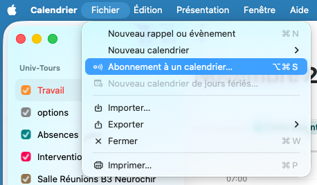
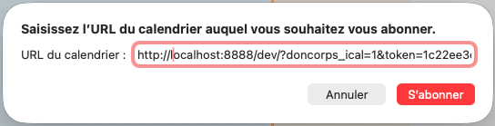
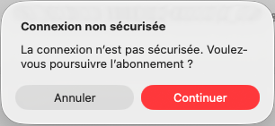
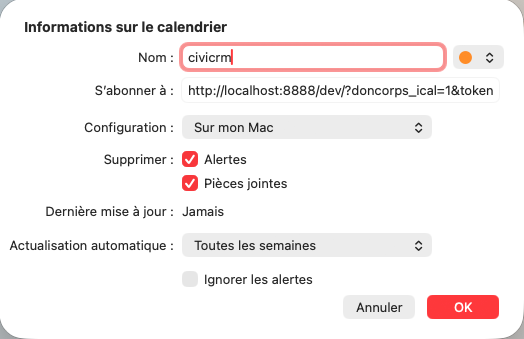
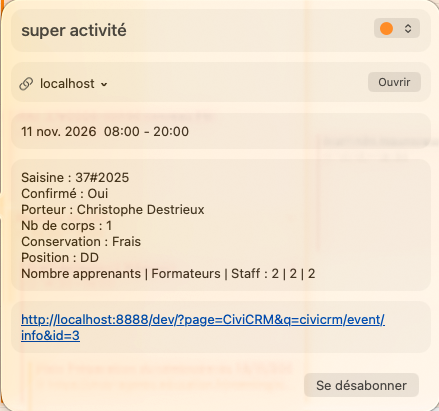

# Gestion du calendrier

L'application exporte un flux de calendrier au format iCalendar, utilisable avec la plupart des agendas (Calendrier de macOS, Outlook, Thunderbird, Google Agenda…), afin d'afficher dans votre agenda tous les événements du centre : cérémonies, activités…

## Créer votre lien iCalendar

* Allez sur **Événements > Abonnement calendrier** ;
* le bouton **Générer mon URL iCalendar** crée un lien personnel, propre à l'utilisateur connecté, pour s'abonner à ce calendrier ;
* copiez-le avec le bouton **Copier**.

## Abonner votre agenda à ce flux

Par exemple sous macOS, ouvrez l'application **Calendrier**, puis allez dans **Fichier > Nouvel abonnement à un calendrier** :

Collez le lien dans la fenêtre qui s'affiche :

Acceptez l'avertissement de sécurité :

Dans la fenêtre suivante, complétez le nom de votre calendrier, sa couleur, sa fréquence de rafraîchissement… :

Pour rafraîchir immédiatement : **Présentation > Actualiser les calendriers** (ou le raccourci indiqué dans ce menu).

Les événements dont l'**Export Calendrier** n'est pas sur *Non* s'affichent dans l'agenda. En cliquant dessus, vous obtenez les informations principales :

> Le nombre de corps affiché est le nombre de corps non segmentés prévus.  
> Il n'est pas possible de modifier les événements directement dans votre agenda : passez par la gestion des événements de l'application. Les modifications apparaissent dans votre agenda au prochain rafraîchissement, automatique ou manuel.

## Résilier votre abonnement

### Depuis l'application Calendrier

* Faites un clic droit sur le nom du calendrier, dans la liste à gauche de l'écran ;
* choisissez **Se désabonner**.

> Cette action ne modifie pas les événements stockés dans la base de données, mais seulement leur affichage dans votre agenda.

### Depuis l'application CiviCRM

* Allez sur **Événements > Abonnement calendrier** ;
* le bouton **Révoquer mon abonnement** désactive le lien : les événements restent visibles dans votre agenda, mais ne sont plus mis à jour, et un avertissement s'affiche dans l'application Calendrier.